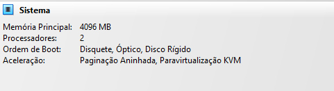
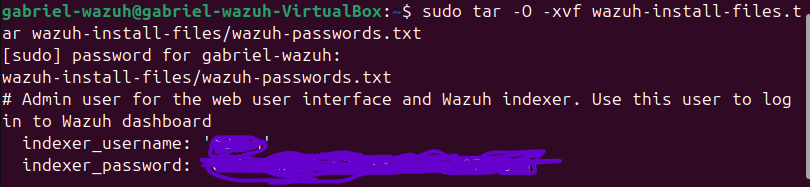
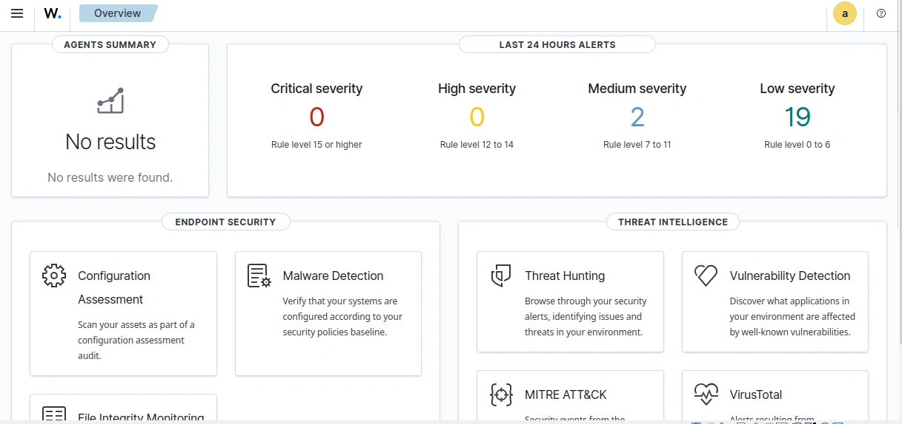

# wazuh-soc-lab
Laboratório prático de implementação do SIEM Wazuh.
# 🛡️ Wazuh SOC Home Lab

**Language:** [English](#english) | [Português](#português)

---

## 🇺🇸 English

### Project Overview
This repository documents the deployment and configuration of a Security Operations Center (SOC) home lab using **Wazuh** (Open-source SIEM/XDR) on an Ubuntu virtual machine. The goal was to simulate a real-world security monitoring environment, from the initial installation to API integration and dashboard configuration.

### Infrastructure & Environment
- **Hypervisor:** Oracle VirtualBox
- **Operating System:** Ubuntu 24.04 LTS (Desktop)
- **Hardware Allocated:** 4 GB RAM / 50 GB Disk / 2 CPUs
- **Wazuh Version:** 4.9.2
- **Components:** Wazuh Indexer, Wazuh Manager, Wazuh Dashboard, Filebeat.

### Technical Challenges & Solutions (Troubleshooting)
During the implementation, several issues were encountered and resolved. This section highlights the problem-solving process:

1. **Disk Space Error (`No space left on device`):**
   - *Cause:* The initial VM disk partition was insufficient for Wazuh requirements.
   - *Solution:* Expanded the virtual disk in VirtualBox and resized the Linux partition via command line.

2. **Dashboard/Manager API Timeout (`Timeout of 20000ms exceeded`):**
   - *Cause:* The Dashboard was timing out while waiting for the Manager API during service initialization.
   - *Solution:* Increased the timeout limit in the `wazuh.yml` configuration file from 20,000ms to 60,000ms.

3. **Browser Access Issues (`Unable to connect` / `Invalid URL`):**
   - *Cause:* Firefox blocking self-signed certificates and VirtualBox NAT network restrictions.
   - *Solution:* Configured Port Forwarding in VirtualBox (Host 8443 -> Guest 443) and adjusted browser network settings.

4. **Update Check Error (`ECONNREFUSED`):**
   - *Note:* The dashboard shows an `ECONNREFUSED` error when trying to check for updates. This is due to VirtualBox NAT network restrictions in the lab environment. It does not affect the main API communication (Status: Online).

### Evidence (Screenshots)
*(Click on the images to enlarge)*

| Step | Description | Image |
| :--- | :--- | :--- |
| 1 | VM Hardware Settings |  |
| 2 | Installation Completed |  |
| 3 | Dashboard Overview |  |
| 4 | API Connection Online |  |
| 5 | Services Running |  |

### Roadmap
- [x] Wazuh All-in-One installation.
- [x] Network configuration and Dashboard access.
- [ ] Deploy Wazuh Agent on a Windows host.
- [ ] Create custom rules for brute-force detection.

---

## 🇧🇷 Português

### Visão Geral do Projeto
Este repositório documenta a implementação e configuração de um laboratório de SOC (Security Operations Center) utilizando o **Wazuh** (SIEM/XDR open-source) em uma máquina virtual Ubuntu. O objetivo foi simular um ambiente real de monitoramento de segurança, desde a instalação inicial até a integração da API e configuração do dashboard.

### Infraestrutura e Ambiente
- **Hypervisor:** Oracle VirtualBox
- **Sistema Operacional:** Ubuntu 24.04 LTS (Desktop)
- **Hardware Alocado:** 4 GB de RAM / 50 GB de Disco / 2 CPUs
- **Versão do Wazuh:** 4.9.2
- **Componentes:** Wazuh Indexer, Wazuh Manager, Wazuh Dashboard, Filebeat.

### Desafios Técnicos e Soluções (Troubleshooting)
Durante a implementação, alguns obstáculos foram encontrados e resolvidos. Esta seção destaca o processo de resolução de problemas:

1. **Erro de Espaço em Disco (`No space left on device`):**
   - *Causa:* A partição de disco inicial da VM era insuficiente para os requisitos do Wazuh.
   - *Solução:* O disco virtual foi expandido no VirtualBox e a partição Linux foi redimensionada via linha de comando.

2. **Timeout na API do Dashboard/Manager (`Timeout of 20000ms exceeded`):**
   - *Causa:* O Dashboard desistia de esperar a resposta da API do Manager durante a inicialização dos serviços.
   - *Solução:* O tempo limite (timeout) foi aumentado no arquivo `wazuh.yml` de 20.000ms para 60.000ms.

3. **Problemas de Acesso via Navegador (`Unable to connect` / `Invalid URL`):**
   - *Causa:* Bloqueio do Firefox a certificados autoassinados e restrições de rede NAT do VirtualBox.
   - *Solução:* Configurado Redirecionamento de Portas (Port Forwarding) no VirtualBox (Host 8443 -> Guest 443) e ajustadas as configurações de rede do navegador.

4. **Erro na Checagem de Atualizações (`ECONNREFUSED`):**
   - *Nota:* O dashboard exibe um erro `ECONNREFUSED` ao tentar verificar atualizações. Isso ocorre devido às restrições de rede NAT do VirtualBox no ambiente de laboratório. Não afeta a comunicação principal com a API (Status: Online).

### Evidências (Prints)
*(Clique nas imagens para ampliar)*

| Etapa | Descrição | Imagem |
| :--- | :--- | :--- |
| 1 | Configuração da VM |  |
| 2 | Instalação Concluída |  |
| 3 | Visão do Dashboard |  |
| 4 | API Online |  |
| 5 | Serviços Ativos |  |

### Roadmap
- [x] Instalação do Wazuh All-in-One.
- [x] Configuração de rede e acesso ao Dashboard.
- [ ] Instalar Agente Wazuh em um host Windows.
- [ ] Criar regras customizadas para detecção de força bruta.
